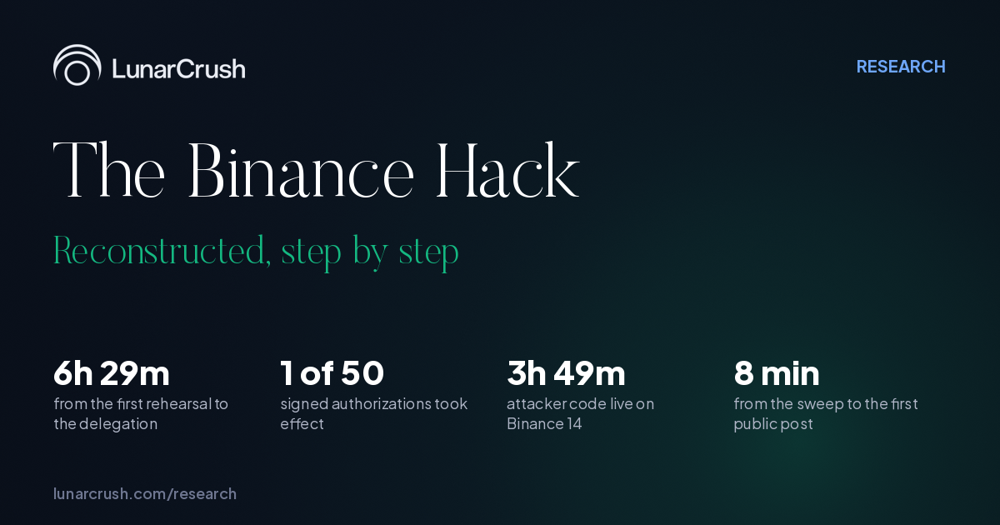
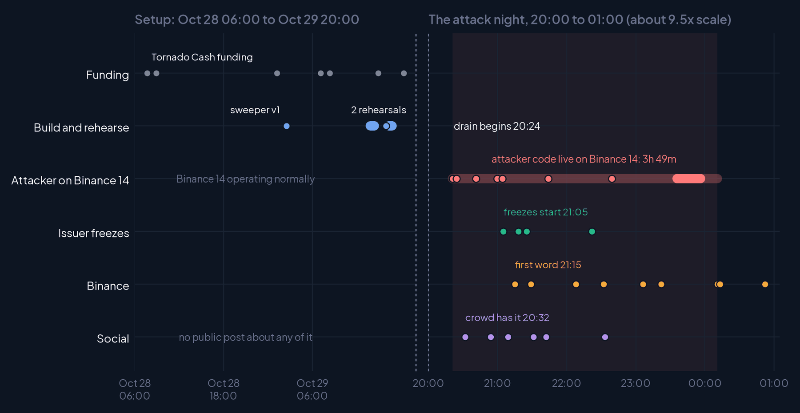

# The Binance Hack, Reconstructed

**LunarCrush Research · October 2026**

[](https://joevezzani.github.io/binance-hack-reconstructed/)

On October 29, 2026 a wallet funded only through Tornado Cash attached its own code to Binance 14, one of the exchange's main Ethereum hot wallets, and swept it in a single transaction. Every step had been rehearsed on mainnet that afternoon. The attacker's code then stayed on the wallet for 3 hours 49 minutes. Stablecoin issuers froze what they could inside the first hour; Binance said at 00:13 UTC that it would cover all losses and at 00:52 that about $3 billion was frozen.

This repository holds the full 77-page report, every dataset behind it, the raw on-chain reads, and the code that builds it.

**[Download the report (PDF, 77 pages)](https://github.com/JoeVezzani/binance-hack-reconstructed/releases/latest/download/LunarCrush-Binance-Hack-Reconstructed.pdf)** · [Web page](https://joevezzani.github.io/binance-hack-reconstructed/)

| | |
|---|---|
| **6h 29m** | from the first rehearsal to the delegation |
| **1 of 50** | signed authorizations took effect |
| **3h 49m** | attacker code live on Binance 14 |
| **8 min** | from the sweep to the first public post |



## What is in the report

- **Part I, the hack, in six acts.** The setup (mixer funding, two sweeper contracts, two rehearsals), the drain, the 3h 49m open door, the response, where the money is, and how fast the public record rebuilt each step. Every step carries its time, what the chain shows and the first public post that described it.
- **Could it have been stopped?** Five signals that were public before or during the drain, and the issuer freezes that worked.
- **Part II, how the world found out.** Fourteen chapters on 114M engagements in 24 hours: who broke it, who carried it, the official response, narratives, sentiment, newcomers, networks, stablecoins, exchanges, markets, comparisons with past events, and the claim ledger.
- **Appendix.** The technical record with addresses and transactions, sources and definitions, and tables.

## Data

Everything in `data/` ships as CSV and Parquet. Schemas and quoting rules: [`data/lc_binance_hack_ai_guide.md`](data/lc_binance_hack_ai_guide.md).

| File | Rows | Contents |
|---|---|---|
| `lc_binance_hack_events` | 44 | Every event on the timelines: time, lane, detail, first public post |
| `lc_binance_hack_timeline` | 28 | The six acts as timestamped steps |
| `lc_binance_hack_positions` | 17 | Every traced balance, read live on six chains, with freeze status |
| `lc_binance_hack_top_posts` | 59 | Most-engaged posts of the event window: account, network, followers, engagements, link |

`onchain/` holds the evidence: the decoded delegation transaction, the operator's full history, the sweeper contract source, nonce sequences, and `reverify_20261030T032016Z/`, about 220 raw requests and responses from the live balance reads (03:20 to 03:27 UTC, October 30), each with its timestamp. [`REPORT.md`](onchain/reverify_20261030T032016Z/REPORT.md) there lists every claim against its live value.

## Reproduce it

**1. Check the chain yourself.** Standard library only, public keyless endpoints:

```bash
python3 verify/replay_reads.py                  # replay all ~220 reads, report what changed
python3 verify/replay_reads.py --only eth_ sol_  # or a subset by filename prefix
```

Balances move and new blocks arrive, so some reads will show as changed; the recorded responses are the state at the time of the report.

**2. Rebuild the PDF and charts.**

```bash
pip install -r requirements.txt
cd build
python3 build_story_charts.py   # timelines, Gantt, lag, freeze ladder, cover
python3 build_flow_v2.py        # money flow and positions, from the live reads
python3 run_clean_charts.py     # social-data charts
python3 build_report_v2.py      # writes LunarCrush-Binance-Hack-Reconstructed-2026-10-29.pdf at the repo root
python3 build_web_datasets.py   # regenerates data/
```

Content lives in `part1.json` (summary and the six acts), `chapters_v2/` (the chapters), `synthesis.json` (the night in numbers and the minute-by-minute table) and `analysis.json` (computed social metrics). Fonts: see [`build/fonts/README.md`](build/fonts/README.md).

**3. Re-pull the social data.** `social/pull.py` and `social/analyze.py` rebuild `analysis.json` from the [LunarCrush](https://lunarcrush.com) CLI and need an API key. Raw API pulls are not included.

## Method

- **Ethereum:** transactions, receipts, contract code and the 50 EIP-7702 authorizations decoded from a public JSON-RPC node; address histories and token transfers from the Blockscout API.
- **Balances:** read live on Ethereum, Bitcoin (mempool.space), Tron (TronGrid), XRP Ledger (s1.ripple.com), Solana and Arbitrum. Freeze status read from each token contract. Prices: CoinGecko at 03:22 UTC; stablecoins at face value.
- **Social:** LunarCrush topic, keyword and post data across X, TikTok, YouTube, Instagram, Reddit and news, pulled 01:00 to 01:30 UTC on October 30. Each on-chain step is matched to the first public post that described it.
- **Attribution:** the Bitcoin, Tron, XRP and Solana senders are attributed to Binance by Whale Alert labels. Loss figures are attributed to whoever published them; Binance had not confirmed a loss total.

## License

Report, text, charts and data: [CC BY 4.0](https://creativecommons.org/licenses/by/4.0/), credit "LunarCrush Research". Code: MIT. See [`LICENSE`](LICENSE).
